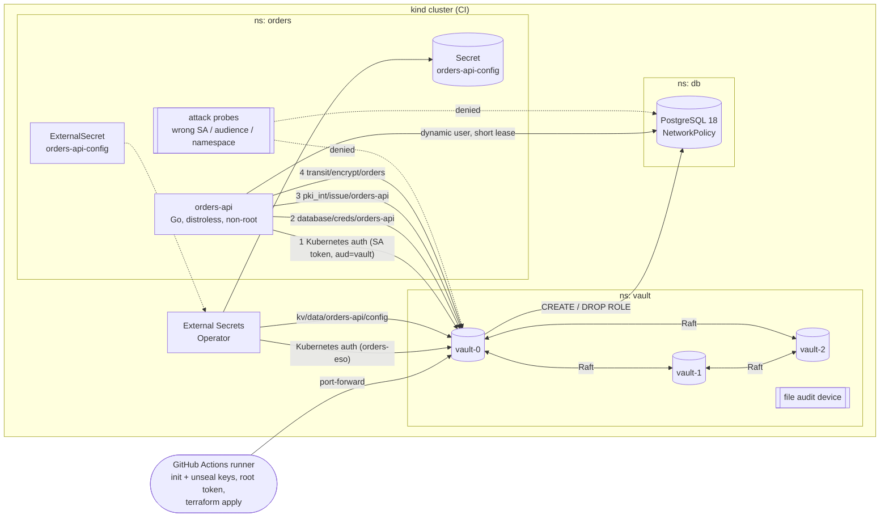

# vault-secrets-platform

[](https://github.com/ahmedelgmal310/vault-secrets-platform/actions/workflows/ci.yml)
[](LICENSE)

Secrets management on Kubernetes with **HashiCorp Vault**. A Go service runs with **no
static secrets at all**: it logs in with its Kubernetes service account, gets a
**dynamic PostgreSQL user** that lives for seconds, serves HTTPS with a **short-lived
certificate from Vault PKI** that it rotates in memory, and encrypts data with
**transit** so the key never leaves Vault. **External Secrets Operator** syncs a static
KV secret into a Kubernetes `Secret` for workloads that cannot talk to Vault.
**Policies are code** (HCL, linted for least privilege) and the whole configuration is
**Terraform**.

Every push re-proves the claims on a throwaway **kind** cluster: a 3-node Raft Vault is
initialised and unsealed on the runner, credentials are shown to **expire**, **revoke**
and **rotate**, wrong identities are shown to be **denied**, the **audit log** is shown to
record it, and the active Vault node is killed to show **failover**. If any of that does
not happen, the job fails.

## Contents

- [The problem](#the-problem)
- [Architecture](#architecture)
- [How it works](#how-it-works)
- [Results from CI](#results-from-ci)
- [Security model](#security-model)
- [Quality gates](#quality-gates)
- [Limitations](#limitations)
- [Runbook](#runbook)
- [Repository layout](#repository-layout)
- [Local development](#local-development)

## The problem

The usual way an application gets a database password is a long-lived value in a
Kubernetes `Secret` (base64, readable by anyone who can read the namespace), copied into
CI variables and `.env` files, shared by every replica, and rotated "when someone
leaves". If it leaks, it works until a human notices. The same is true of TLS keys
created once and mounted for a year, and of encryption keys that live next to the data.

This project removes those long-lived secrets:

| Instead of | This platform uses | So a leak is worth |
|---|---|---|
| A shared DB password in a `Secret` | A unique PostgreSQL role per lease, created on demand by Vault, renewed while used, dropped at `max_ttl` | at most 60 s, and the role no longer exists afterwards |
| A TLS key on disk for months | A certificate from Vault PKI with a 2-minute TTL, key created per certificate, held only in memory | 2 minutes, for one hostname |
| An app-held encryption key | Vault transit (`aes256-gcm96`, not exportable) | nothing: the app never sees the key |
| A token in an env var | A projected service account token (audience `vault`, 10 min) exchanged for a Vault token | a token that only works against one Vault role, from one namespace |

## Architecture



**Why Vault and not OpenBao.** OpenBao (the MPL fork) would work the same way here and
ESO supports both. I used HashiCorp Vault because it is what most job descriptions name,
the official Helm chart and images are maintained and pinned by digest, and the BSL 1.1
licence allows this kind of use (it only restricts offering Vault as a competing
product). The Vault client in this repo is a small HTTP client, so switching to OpenBao
is a chart and image change, not a code change.

## How it works

### 1. Bootstrap: init and unseal on the runner

[`e2e/vault-init.sh`](e2e/vault-init.sh) calls `sys/init` on `vault-0` with **5 key
shares and a threshold of 3**. The response (keys + root token) goes straight into a
mode-600 file in `$RUNNER_TEMP`, outside the workspace, and every value is masked in the
log. Keys are sent to `sys/unseal` on stdin through a port-forward, never as command
arguments. `vault-1` and `vault-2` join with `sys/storage/raft/join` and are unsealed the
same way; the script then waits for autopilot to report **3 healthy voters**. At the end
of the job [`e2e/cleanup.sh`](e2e/cleanup.sh) revokes the root token and deletes the
private directory. Nothing from this step is uploaded.

### 2. Configuration: Terraform

[`terraform/`](terraform) (vault provider, lock file committed) configures everything:

| File | What |
|---|---|
| [`auth.tf`](terraform/auth.tf) | Kubernetes auth; roles `orders-api` and `eso-orders`, each bound to **one service account in one namespace** and to the audience `vault` |
| [`database.tf`](terraform/database.tf) | Database engine, PostgreSQL connection (`vault_admin`), role `orders-api`: `default_ttl` 20 s, `max_ttl` 60 s; creation with `VALID UNTIL`, revocation that **terminates live sessions** then drops the role |
| [`pki.tf`](terraform/pki.tf) | Two-tier PKI (EC P-256): root CA `pki`, intermediate `pki_int`, role `orders-api` limited to `orders-api.orders.svc[.cluster.local]`, TTL 2 min, max 5 min, `no_store` |
| [`engines.tf`](terraform/engines.tf) | Transit key `orders` (not exportable, not deletable), KV v2 at `kv/`, file audit device |
| [`policies.tf`](terraform/policies.tf) + [`policies/*.hcl`](terraform/policies) | The two ACL policies, as reviewable HCL files |

Right after `apply`, [`e2e/configure.sh`](e2e/configure.sh) calls
`database/rotate-root/orders-postgres`. From then on **only Vault knows the
`vault_admin` password**, and CI checks that the bootstrap password is rejected.

### 3. The service

[`cmd/orders-api`](cmd/orders-api) starts by logging in, then keeps three loops running:

- **Vault token** ([`internal/vault/session.go`](internal/vault/session.go)): renew at
  2/3 of the TTL; when renewal fails or is capped by `token_max_ttl`, log in again with
  the (kubelet-rotated) projected token.
- **Database credential** ([`internal/dbcreds`](internal/dbcreds)): renew the lease at
  2/3 of its remaining life. When Vault grants less than asked (max_ttl is near) or
  renewal fails, read a new credential, open and ping a **new pgx pool**, swap it in
  atomically, close the old pool, and **revoke the old lease** right away.
- **TLS certificate** ([`internal/certs`](internal/certs)): `tls.Config.GetCertificate`
  serves the current certificate; a new one is issued at 2/3 of its lifetime. The private
  key is created by Vault per certificate and stays in memory.

Order notes go through `transit/encrypt/orders` before the `INSERT`, so PostgreSQL
only stores `vault:v1:...` ciphertext. `/status` reports the current DB username,
lease expiry, renewal and rotation counts and the certificate serial, never a secret.

| Endpoint | Purpose |
|---|---|
| `GET /healthz`, `GET /readyz` | Probes (ready only with a DB credential and a certificate) |
| `GET /status` | Vault session, DB lease and TLS state (no secrets) |
| `GET /v1/db/whoami` | `SELECT current_user`: proves which dynamic user the pool uses |
| `POST /v1/orders`, `GET /v1/orders/{id}` | Insert with transit-encrypted note, read back with decryption |

### 4. Least privilege, as code

[`terraform/policies/orders-api.hcl`](terraform/policies/orders-api.hcl) grants exactly
five paths: read its DB credential, revoke leases under that one path, issue its own
certificate, encrypt and decrypt with its own key.
[`eso-orders.hcl`](terraform/policies/eso-orders.hcl) grants one path: read
`kv/data/orders-api/config`.

[`cmd/policylint`](cmd/policylint) fails CI if a policy uses a glob or `+`, grants
`sys/` or `auth/`, uses `sudo`, or adds parameters inside a block. A deliberate exception
needs a comment with a reason on the line above the path; the one exception in this repo
is the scoped revoke path, and the lint rejects an exception without a reason.

### 5. Proof: the e2e scenario

Each step of the `e2e` job is one script in [`e2e/`](e2e). Every check is an assertion;
the job fails on the first mismatch.

| Script | Asserts |
|---|---|
| [`test-dynamic-db.sh`](e2e/test-dynamic-db.sh) | A fresh credential logs in; Vault drops the role when the lease expires; the expired password is refused. A revoked lease kills an open session and blocks new logins. orders-api renews, rotates to a different user at max_ttl, queries as the new user, and the old role is gone |
| [`test-pki.sh`](e2e/test-pki.sh) | The served chain verifies against the Vault root; lifetime ≤ role max; another hostname is rejected; the serial changes before expiry and no poll ever sees an expired certificate |
| [`test-transit.sh`](e2e/test-transit.sh) | The stored note is `vault:v1:` ciphertext, the plaintext is nowhere in the table, the row was written by the current dynamic user, and decryption round-trips |
| [`test-eso.sh`](e2e/test-eso.sh) | The KV value appears in the Kubernetes Secret; a new version propagates; the Secret is owned by the ExternalSecret |
| [`attacks.sh`](e2e/attacks.sh) | Five probe Jobs ([`deploy/attacks`](deploy/attacks)) built from [`cmd/vaultprobe`](cmd/vaultprobe); every allow and every deny must match |
| [`test-audit.sh`](e2e/test-audit.sh) | The audit log contains the service logins, denied logins, DB credential reads, lease renewals, certificate issues, ESO reads and permission-denied responses; no secret value appears in plaintext and DB passwords are HMAC-ed |
| [`test-failover.sh`](e2e/test-failover.sh) | Deleting the active node elects a new leader, the node rejoins after unseal, and orders-api keeps renewing and serving |

## Results from CI

These numbers come from CI run
[#40609910765](https://github.com/ahmedelgmal310/vault-secrets-platform/actions/runs/40609910765)
on `main` (all 7 jobs green, e2e job 5 min 14 s): kind v0.33.0, Kubernetes v1.36.4, Vault
2.1.2 (3-node Raft), PostgreSQL 18.6, External Secrets Operator 2.12.0. Every run posts the
same table in its job summary and uploads `results.json`, the probe results and a redacted
audit excerpt as the `e2e-results` artifact.

| Scenario | Measured |
|---|---|
| Vault bootstrap: init (5 shares, threshold 3), unseal, Raft join | **3 healthy voters** in 31.5 s |
| Terraform apply | 20 resources in 2.8 s; second `plan` reports **no drift** |
| `vault_admin` after `rotate-root` | bootstrap password **rejected** (only Vault knows the new one) |
| orders-api from `kubectl apply` to ready (login + cert + DB credential) | 2.9 s, **0** Kubernetes Secret references in the pod |
| **Dynamic credential expiry**: lease TTL → role dropped by Vault | 20 s TTL → role gone **20.5 s** after issue |
| Login with the expired credential | `FATAL: password authentication failed` |
| **Revocation**: `lease revoke` → open session terminated | **0.1 s**; new logins refused, role dropped |
| **Service rotation**: orders-api renewed its lease 4 times, then switched user at max_ttl | **58 s** (max_ttl 60 s); old role dropped, no sessions left, queries run as the new user |
| TLS certificate served by orders-api | **150 s** lifetime (120 s TTL + 30 s backdate), chain of 3, verifies against the Vault root; wrong hostname rejected |
| TLS rotation in memory | new serial with **≥ 50 s** of validity left on the old one; no expired certificate at any of the polls |
| Transit | DB stores `vault:v1:…`; **0** rows contain the plaintext; row written by the current dynamic user |
| ESO: initial sync / rotated value reaches the Kubernetes Secret | 1.5 s / **4.3 s** (refreshInterval 5 s) |
| **Access probes** | **22/22** outcomes as expected: 4 allowed, **18 denied** |
| Audit log (active node) | 254 entries: 2 service logins, **4 denied logins**, 3 DB credential reads, 6 lease renewals, 5 ESO reads, **10 permission-denied** responses, **0** plaintext secret values |
| **Leader failover**: delete the active pod | new leader in **6.5 s**; old node unsealed and back in 8.2 s; 3 voters; orders-api kept renewing and serving |
| Root token at end of job | revoked (`lookup-self` → HTTP 403) |
| Go unit tests | coverage **88.1%** (gate 80%), race detector on |

The four denied logins, with Vault's own reasons (from the probe output and the audit log):

| Probe | Identity | Vault's answer |
|---|---|---|
| `wrong-service-account` | SA `intruder` in `orders`, role `orders-api` | 403 `service account name not authorized` |
| `wrong-service-account-eso-role` | SA `intruder` in `orders`, role `eso-orders` | 403 `service account name not authorized` |
| `wrong-namespace` | SA `orders-api` in namespace `rogue` | 403 `namespace not authorized` |
| `wrong-audience` | the real SA, but its default API-server token | 403 `invalid audience (aud) claim` |

And what the legitimate identity was refused (`least-privilege` probe): reading the ESO
KV secret, listing database roles, reading the DB connection config, `rotate-root`, signing
with the root CA, a certificate for `evil.example.com` (refused by the PKI role, HTTP 400),
another transit key, rotating or exporting its own transit key, creating tokens, reading
`sys/audit`, and opening a TCP connection to PostgreSQL from a pod that is not orders-api
(NetworkPolicy). Each of the ten policy denials appears in the audit log with the
caller's identity `orders/orders-api`.

## Security model

| Threat | Control | Proven by |
|---|---|---|
| Stolen DB password | Per-lease PostgreSQL role, 20 s TTL, 60 s max, dropped on expiry and on rotation; `VALID UNTIL` as a second fence | `test-dynamic-db.sh` A and C |
| Credential still in use after compromise is detected | `vault lease revoke` runs `pg_terminate_backend` then `DROP ROLE` | `test-dynamic-db.sh` B |
| Another pod impersonates the service | Role bound to SA name **and** namespace **and** audience | probes `wrong-service-account`, `wrong-namespace`, `wrong-audience` |
| Compromised service reaches for more | Policy with five paths (no wildcards except the scoped revoke); PKI role restricts names | probe `least-privilege` (11 denied Vault calls) |
| Lateral movement to the database | NetworkPolicy: only Vault and orders-api pods reach 5432 | probes' `tcp postgres.db.svc:5432` checks |
| Leaked TLS key | 2-minute certificates, key in memory only, `no_store` | `test-pki.sh` |
| Secret values in logs | Audit device HMACs secrets; scripts mask and never print values | `test-audit.sh` leak check, Gitleaks |
| Bootstrap secrets escaping CI | Keys and root token only in `$RUNNER_TEMP` (mode 600), masked, never uploaded; root token revoked at job end; DB root rotated so Terraform's copy is useless | `cleanup.sh`, `configure.sh` |
| Single Vault node failure | 3-node Raft, autopilot, clients use the `vault-active` service | `test-failover.sh` |

## Quality gates

| Gate | Job | Fails when |
|---|---|---|
| `go vet`, `go test -race`, coverage ≥ 80% | `go` | vet finding, failing or racy test, coverage below the gate |
| govulncheck | `go` | a reachable known vulnerability |
| golangci-lint v2 (gosec, errorlint, revive, gocritic, ...) | `golangci-lint` | any finding |
| Gitleaks (full history), shellcheck, actionlint, hadolint | `static` | any finding |
| Vault policy lint | `static` | wildcard, `sys/`/`auth/`, `sudo` or unexplained exception |
| `terraform fmt`, `validate` (locked provider), tflint | `terraform` | formatting, validation or lint error |
| kubeconform `-strict` with CRD schemas | `manifests` | schema error in any manifest, including ESO resources |
| Trivy (HIGH/CRITICAL, fixed) + CycloneDX SBOM | `image` | fixable HIGH/CRITICAL vulnerability |
| kind e2e | `e2e` | any assertion above |

Every action is pinned to a commit SHA, every image by digest, and every version was
public for at least 14 days when adopted (one documented security exception, Go 1.27.3).
The full list is in [`docs/versions.md`](docs/versions.md). Workflows only get
`contents: read`.

## Limitations

Honest list of what this is not:

- **Plain HTTP inside the cluster.** Vault's listener has `tls_disable = 1` and
  PostgreSQL uses `sslmode=disable`. In production both need TLS (Vault serving a cert
  from its own PKI or cert-manager, PostgreSQL with `verify-full`).
- **Shamir unseal by a CI script.** Real clusters use auto-unseal (cloud KMS/HSM
  transit seal) so no human or pipeline ever handles unseal keys, and keep the root token
  revoked, generating one only with `operator generate-root` under quorum.
- **Bootstrap with the root token.** Terraform runs with the root token for the first
  apply. In production, Terraform would authenticate with its own auth method (for
  example JWT/OIDC from CI) and a scoped admin policy.
- **HA on one node.** The three Vault pods share one kind node, so this proves Raft
  replication and leader election, not resilience to a node or zone failure. Production
  needs pod anti-affinity across nodes and zones and a `PodDisruptionBudget`.
- **TTLs are demo-short.** 20 s / 60 s DB leases and 2-minute certificates make rotation
  visible within a CI run. Typical production values are minutes to hours, sized against
  connection-pool churn and Vault load.
- **ESO sync is not app reload.** The Kubernetes Secret updates within seconds; a pod
  that reads it as an env var still needs a restart (for example Reloader), and mounted
  files update on the kubelet's sync period.
- **No Vault Agent / CSI.** The service uses the Vault API directly. That keeps the
  logic visible and testable but means each language needs its own client.
- **Audit to a local file only.** Production should ship audit logs to a SIEM and alert
  on `permission denied` spikes, and run two audit devices (Vault blocks requests if every
  audit device fails).
- **`no_store` certificates cannot be revoked by serial.** That is the trade-off of
  2-minute certificates: they expire faster than a CRL would propagate.

## Runbook

All commands assume `VAULT_ADDR` points at the active node (for example
`kubectl -n vault port-forward svc/vault-active 8200`) and a token with the right policy.

**A database credential leaked**

```sh
vault list sys/leases/lookup/database/creds/orders-api        # find the lease
vault lease revoke database/creds/orders-api/<lease-id>        # kills sessions, drops the role
vault lease revoke -prefix database/creds/orders-api           # all of them; orders-api re-reads within seconds
```

**The `vault_admin` connection broke** (password changed outside Vault, role dropped):
fix the role in PostgreSQL, write the connection again with a temporary password
(`terraform apply -var db_admin_password=...`) and run
`vault write -f database/rotate-root/orders-postgres` so the temporary password stops
working.

**orders-api is not ready**: `kubectl -n orders logs deploy/orders-api` shows which loop
is failing (`vault login`, `tls certificate issue`, `database credential`). `/status`
has `last_error` per subsystem. A `permission denied` on login usually means the service
account, namespace or token audience does not match the role.

**A Vault pod restarted** (sealed after restart): unseal it with three key holders
(`vault operator unseal` on that pod). It rejoins Raft from its PVC. Check
`vault operator raft autopilot state` for `healthy: true` and three voters.

**Rotate a static secret**: `vault kv put kv/orders-api/config api_key=...`. ESO picks
it up on the next refresh (5 s here); `kubectl -n orders get externalsecret` shows
`SecretSynced`.

**Rotate the transit key**: `vault write -f transit/keys/orders/rotate` (operator
token; the app policy cannot). New writes use `vault:v2:`, old ciphertext still decrypts;
`transit/rewrap` upgrades stored values, then raise `min_decryption_version`.

**Investigate denials**: in the audit log, `jq 'select(.type=="response" and
(.error // "" | contains("permission denied"))) | {time, path: .request.path, who: .auth.display_name}'`.

## Repository layout

```
cmd/orders-api/        the service (login, DB credential, TLS and token loops, HTTP API)
cmd/vaultprobe/        access probe run as Kubernetes Jobs by the attack step
cmd/policylint/        least-privilege linter for Vault policy HCL
internal/vault/        minimal Vault API client, token session, transit
internal/dbcreds/      dynamic credential renew / rotate / revoke
internal/certs/        PKI certificate rotation behind tls.Config.GetCertificate
internal/store/        pgx pool that is swapped on rotation
internal/server/       HTTP handlers
terraform/             Vault configuration (auth, database, PKI, transit, KV, audit, policies)
deploy/                Helm values (Vault, ESO), PostgreSQL, orders-api, ESO resources, attack probes
e2e/                   kind scenario, one script per CI step
docs/versions.md       every pinned version and why
```

## Local development

```sh
go test -race ./...
go run ./cmd/policylint terraform/policies/*.hcl
terraform -chdir=terraform init -backend=false && terraform -chdir=terraform validate
```

The full scenario needs Docker, kind, kubectl, Helm, Terraform and jq:

```sh
kind create cluster --name vault
docker build -t orders-api:ci . && kind load docker-image orders-api:ci --name vault
./e2e/run-all.sh          # results in e2e-results/summary.md
```

## License

[MIT](LICENSE) © 2026 Ahmed Elgamal
